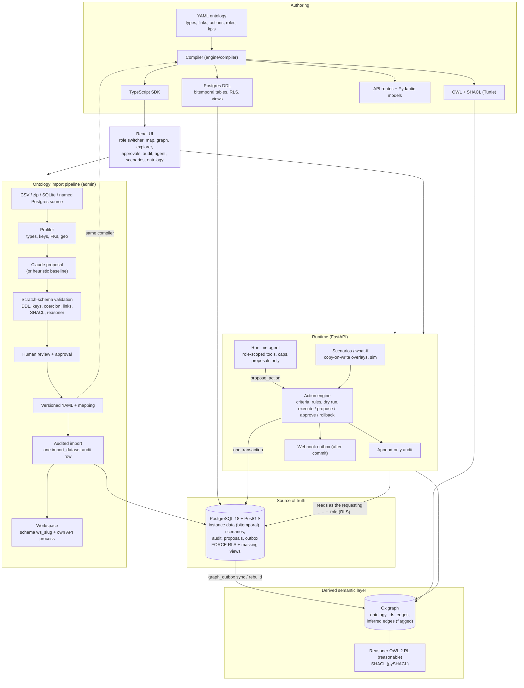

# Isnad architecture

Isnad is an open, Foundry/AIP-inspired ontology platform. One YAML ontology is the single authoring source; Postgres is the
only source of truth; everything else (graph, OWL, API, SDK, UI pages) is derived from the YAML or from Postgres.
The decisions and their sources are in `RESEARCH.md`; the frozen interfaces are in `docs/contracts.md`.

## Diagram



## ASCII fallback

```
                      YAML ontology (single authoring source)
                                   | compiler
        +--------------------------+---------------------------+
        v                          v                           v
  Postgres DDL              OWL + SHACL (Turtle)        API routes / models / TS SDK
        |                          |                           |
 +------v------------+      +------v-----------------+         |
 | PostgreSQL+PostGIS|      | Oxigraph (derived,     |         |
 | SOURCE OF TRUTH   |----->| rebuildable)           |         |
 | bitemporal data   | sync | ontology, ids, edges,  |         |
 | scenarios, audit  |      | inferred edges flagged |         |
 | proposals, outbox |      | + OWL 2 RL, SHACL      |         |
 | FORCE RLS+masking |      +------------------------+         |
 +------^------------+                                         |
        | one transaction                                      |
 +------+---------------------------------------------------+  |
 | Runtime (FastAPI)  <-----------------------------------------+
 |  action engine (criteria, rules, dry run, execute /       |
 |    propose / approve / rollback) -> append-only audit     |
 |    -> webhook outbox (after commit)                       |
 |  runtime agent (role-scoped tools, proposals only)        |
 |  scenarios / what-if (copy-on-write overlays, simulation) |
 +------^----------------------------------------------^----+
        |                                              |
   React UI (role switcher)            Import pipeline (admin):
                                       source -> profiler -> Claude proposal
                                       -> scratch-schema validation -> human
                                       review -> versioned YAML -> audited
                                       import -> workspace (ws_<slug>)
```

## Components

**Ontology and compiler** (`ontology/`, `engine/compiler/`). `ontology/supply_chain.yaml` declares object types, link types
(cardinality, transitive, inverse), classes, actions with criteria and declarative rules, roles with row filters and masks,
agent allowlists, KPIs and an optional `sim:` block. The compiler emits DDL, OWL and SHACL, Pydantic models and a TypeScript
client (`build/`, copied to `sdk/client.ts`). `GET /types` exposes the loaded ontology so the UI builds its pages from it.

**Data layer** (`engine/db/`). Every table has `valid_during` and `recorded_during` ranges (bitemporal), `changed_by`,
`action_id` and `scenario_id`. Reads use `cur_*` (main, current) or `eff_*` (scenario overlay) views; roles read through
`rd_*` masking views. `isnad_app` is a least-privilege role; every request runs in a transaction under
`engine.db.principal.scoped()` (`SET LOCAL ROLE isnad_app` plus `isnad.*` settings), and all policies use FORCE RLS.

**Action engine** (`engine/actions/`). The only write path. An action checks the role, evaluates criteria, applies
declarative rules and writes objects/links and an audit row in one transaction; webhooks go to an outbox and are delivered
after commit. Gated actions become proposals; approval by a named human executes as the approver and is re-checked at
execution time. Audit tables are append-only (triggers reject UPDATE/DELETE/TRUNCATE). Executions can be rolled back.

**Semantic layer** (`engine/sync/`, `engine/reason/`). Oxigraph is rebuilt from Postgres and kept in sync through
`graph_outbox`. The reasoner (OWL 2 RL via `reasonable`, fallback `owlrl`) materialises inferred edges, always flagged and with
provenance; SHACL validates. Multi-hop traversals and SPARQL are filtered per node and per edge; an inferred edge is visible
only if the viewer can see every fact it was derived from. Business rules are functions, not OWL.

**Runtime agent** (`agent/`). A tool loop with role-scoped tools (query, graph, history/as-of/diff, read-only functions,
scenario tools, `propose_action`). Tools take no role, user, schema or SQL. Effective permissions are the intersection of the
user's RLS, the role's actions and the agent allowlist. The agent only creates pending proposals (proposer `agent:<role>`,
`on_behalf_of` the launcher, with evidence and expiry); the launcher cannot approve. Every run is stored append-only with its
tool trace. Model: `agent/model_anthropic.py` (real) or `agent/mock_model.py` (deterministic, for tests and the demo).

**Scenarios and simulation** (`engine/scenarios/`, `sim/`). A scenario is a copy-on-write overlay in the same tables
(`scenario_id`), snapshot at fork. Actions, KPIs, graph and SPARQL are scenario-aware; compare, merge (agent-authored actions
become proposals) and discard are supported. `sim.whatif` runs seeded what-if simulations (port closure, shipment delay,
supplier delay, price shock, invoice anomaly) inside a scenario; the live simulation writes through the same action engine.

**Ontology import** (`engine/ingest/`, `agent/ontogen/`, `engine/api/ingest_routes.py`). Admin-only. A source (CSV/TSV/zip,
SQLite, or a named Postgres source) is stored by hash and profiled (types, keys, foreign-key candidates with containment,
geo and time columns). A proposal comes from the heuristic baseline or from a Claude tool loop over the profile; its output is
validated by `Proposal.model_validate` and turned into YAML only by the deterministic `to_yaml`. Validation loads the data
into a scratch schema and checks DDL, keys, nulls, type coercion, enums, link resolution, SHACL and the reasoner. After a
human approval the import runs in one transaction into a new schema `ws_<slug>`, writes one `import_dataset` audit row and
the workspace files (`workspaces/<slug>/`). A workspace is one schema + one YAML + one API process
(`scripts/serve_workspace.sh`).

**UI** (`web/`). React + Vite + TypeScript, MapLibre/deck.gl, Cytoscape, ECharts. The role switcher sends `x-role`. Pages:
dashboard, map, graph, explorer, audit, approvals, agent console, scenarios, ontology (import wizard and version manager,
admin only).

## Invariants

1. Postgres is the only source of truth; Oxigraph can always be rebuilt from YAML + Postgres.
2. Writes happen only through action types, in one Postgres transaction; side effects go through the outbox after commit.
3. Permissions are enforced in the API and the database (RLS with FORCE), never only in prompts.
4. Agent permissions are an intersection, never a union; the agent proposes, a human approves.
5. Hidden objects look identical to missing ones; losing access removes access to past versions.
6. Everything that comes from data or a model is untrusted: identifiers pass through `engine.ingest.names`, generated
   ontologies use declarative rules and the five generic actions only (no functions, no webhooks, no custom handlers).
